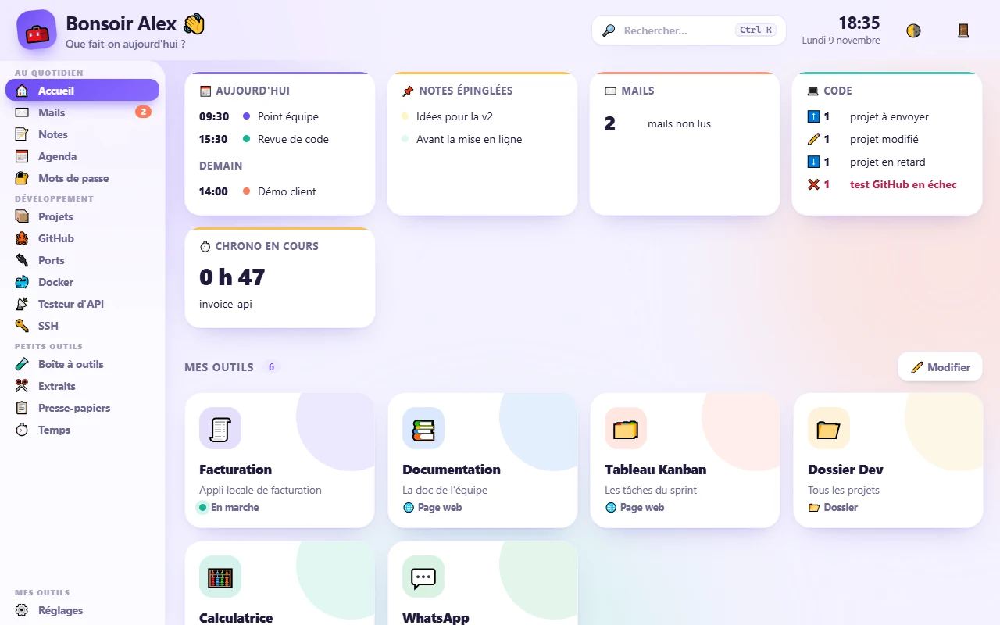

# Mes outils

⬇️ **[Télécharger Mes outils pour Windows (Setup.exe)](https://github.com/rarianaAina/mes-outils/releases/latest/download/Mes-outils-Setup.exe)** · rien d'autre à installer

📖 **[Guide d'utilisation illustré](docs/GUIDE.md)** · **[Illustrated guide (English)](docs/GUIDE.en.md)**



Un tableau de bord personnel pour Windows, pensé pour les développeurs : une
petite bulle 🧰 flotte sur l'écran et ouvre, d'un clic, vos projets, vos
serveurs de dev, GitHub, vos mails, notes, agenda, mots de passe et une boîte
à outils.

Tout tourne sur votre PC : un petit serveur local (`127.0.0.1:8760`, inaccessible
depuis l'extérieur) et une page affichée dans une fenêtre Edge sans barre
d'adresse. Aucun compte, aucun service en ligne. Interface en français ou en
anglais, thème clair ou sombre, palette de commandes (Ctrl + K).

## Ce qu'il fait

**Au quotidien**
- **Tuiles** : dossiers, fichiers, programmes, pages web ou applis locales.
- **Mails** : Gmail, Yahoo, iCloud, Zoho, Fastmail, GMX, OVH, Orange, Free,
  La Poste ou tout serveur IMAP/SMTP ; mot de passe dans le coffre de Windows.
- **Notes**, **Agenda** (rappels par la bulle), **Mots de passe** (coffre
  chiffré AES-256-GCM, clé tirée du mot de passe maître par scrypt).

**Développement**
- **Projets** : vos projets détectés (Node, Python, Django, Docker, Odoo…),
  ouverts dans VS Code, un terminal ou le navigateur ; serveurs de dev
  démarrés et arrêtés en un clic, avec leur journal ; état Git de chaque
  projet (à envoyer, modifié, en retard) ; fichiers `.env` sauvegardés dans le
  coffre chiffré.
- **GitHub** : tous vos dépôts, clonage, création d'un dépôt à partir d'un
  dossier (contenu vérifié avant l'envoi), pull requests, issues, état des
  GitHub Actions (pastille rouge sur la bulle en cas d'échec). Connexion par un
  code à valider sur github.com, sans mot de passe.
- **Ports** : quel programme occupe le port 3000 ? Arrêt en un clic (les
  processus système sont protégés).
- **Docker** : conteneurs groupés par projet compose, démarrer, arrêter,
  journaux.
- **Testeur d'API** : un mini Postman (historique sans secrets, cURL).
- **SSH** : une clé par serveur, déposée en un clic, puis `ssh <nom-court>`.

**Petits outils**
- **Boîte à outils** : JWT, Base64, JSON, horodatage, UUID, expressions
  régulières, encodage URL, empreintes SHA, couleurs.
- **Extraits** : vos commandes et bouts de code favoris, copiés en un clic.
- **Presse-papiers** : les 50 derniers textes copiés (en mémoire seulement ;
  les mots de passe du coffre n'y entrent pas).
- **Temps** : chrono par projet, Pomodoro, export CSV pour la facturation.

## Installation

**Le plus simple** : téléchargez **[Mes-outils-Setup.exe](https://github.com/rarianaAina/mes-outils/releases/latest/download/Mes-outils-Setup.exe)** et
lancez-le. Python et tout le nécessaire sont inclus, sans droits
administrateur. Windows peut afficher « Windows a protégé votre ordinateur »
(installateur non signé) : **Informations complémentaires › Exécuter quand
même**. Vos réglages et données sont dans `%APPDATA%\Mes outils`.

**Depuis le code source** (pour contribuer) : Python 3.10+ avec tkinter, puis

```bat
git clone https://github.com/rarianaAina/mes-outils.git
cd mes-outils
installer.bat
```

Les données sont alors à côté du code (`outils.json`, `donnees\`, exclus du
dépôt). Pour utiliser un autre Python que celui du PATH : variable
`MES_OUTILS_PYTHON` (chemin de `pythonw.exe`).

**Construire l'installateur** : `pip install pyinstaller`, Inno Setup 6, puis
`powershell -ExecutionPolicy Bypass -File packaging\construire.ps1`. Une
étiquette `vX.Y.Z` poussée sur GitHub le construit et le publie tout seul
(`.github/workflows/version.yml`).

## Ajouter un onglet

Un onglet = un fichier Python et un fichier JavaScript, sans toucher au
reste : voir [docs/MODULES.md](docs/MODULES.md).

## Tests

```bat
python -m unittest discover -s tests
```

## Mode d'emploi

- [Guide d'utilisation illustré](docs/GUIDE.md) ([English](docs/GUIDE.en.md))
- Tout le détail, onglet par onglet : [LISEZMOI.txt](LISEZMOI.txt)

## Licence

[MIT](LICENSE)
